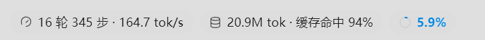
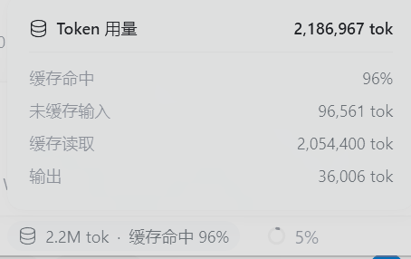
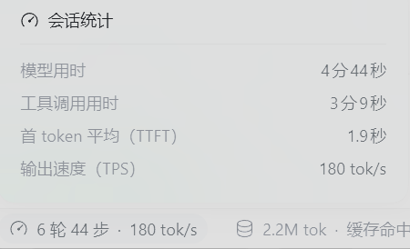

# Antigravity Context & Session Monitor 🚀

<div align="center">

[](https://opensource.org/licenses/MIT)
[](https://nodejs.org/)
[](#)
[](#)

**A sleek, non-intrusive bottom-bar monitoring widget & interactive dashboard for Google Antigravity**  
Real-time TPS Flow · Animated Shimmer Context Bar · Session Average Speed · Token Cache Stats · Click-to-Inspect Cards

[简体中文](./README.md) | [English](./README_EN.md)

</div>

---

## 🌟 Overview & Key Features

### 1. Minimalist Bottom Capsule Bar
Embedded right next to the model selector button in Antigravity's chat interface:

<div align="center">
  
</div>

- **Capsule 1 (`⏱` Session Stats)**: `{Rounds} rounds {Steps} steps · {⚡ Live TPS / 0 tok/s}`
- **Capsule 2 (`🗄` Token Usage)**: `{Cumulative Throughput} · Cache Hit {Percentage}%`
- **Capsule 3 (`⭕` Context Capacity)**: Color-coded mini progress ring (Blue < 50%, Amber 50-80%, Red > 80%).

---

### 2. Three Interactive Cards (Click to Toggle, Click-outside to Dismiss)

<div align="center">
  <table>
    <tr>
      <td align="center"><b>Session Stats Card</b></td>
      <td align="center"><b>Token Usage Details Card</b></td>
    </tr>
    <tr>
      <td></td>
      <td></td>
    </tr>
  </table>
</div>

- **Card 1: Session Stats (Click Capsule 1)**:
  - **Model Time**: Cumulative active generation time of the model.
  - **Tool Execution Time**: Cumulative time spent executing tools/commands.
  - **Time to First Token (TTFT)**: Average response latency.
  - **Real-time Speed (TPS)**: Live streaming rate while generating (`⚡ 549 tok/s`); drops to `0 tok/s` when idle.
  - **Session Average Speed**: Globally weighted throughput rate across the entire conversation.
  - **Recent Peak Speed**: Preserved record of the latest completed turn.

- **Card 2: Token Usage (Click Capsule 2)**:
  - **Total Throughput & Cache Hit**: Cumulative token counter with highlighted cache hit rate (e.g., `94%`).
  - **Breakdown**: Uncached input, cache read, and model output tokens.

- **Card 3: Context Capacity (Click Capsule 3)**:
  - **Left-to-Right Shimmer Bar**: Animated streaming light effect (`@keyframes agy-beam-slide`).
  - **Turn Consumption vs 1.0M**: Current single-turn context size (e.g. `47.2k / 1.0M`).
  - **Turn Cache Ratio**: Breakdown of cache hit tokens vs fresh tokens for the current turn.

---

## 🛠️ Installation & Usage

### Prerequisites
- [Node.js](https://nodejs.org/) (v18 or newer).
- An active [Antigravity](https://antigravity.google) client instance.

---

### Option 1: One-Click Windows Batch (Recommended)

1. Clone or download this repository:
   ```bash
   git clone https://github.com/lizhuo520/antigravity-context-monitor.git
   cd antigravity-context-monitor
   ```
2. Double-click `install.bat` to detect and inject the widget instantly!

---

### Option 2: Command Line Injection

```bash
git clone https://github.com/lizhuo520/antigravity-context-monitor.git
cd antigravity-context-monitor

npm start
# or
npm run inject
```

---

### Option 3: Continuous Daemon Mode

To keep the widget injected automatically across window reloads or restarts:

```bash
npm run daemon
```

---

## 📄 License

This project is licensed under the [MIT License](./LICENSE). Contributions and pull requests are warmly welcome!
